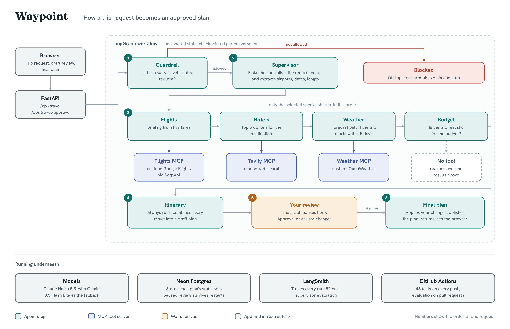

# Waypoint

A multi-agent travel planner. You describe a trip in plain language, a supervisor agent decides which specialists the request needs, they fetch live flight fares, hotels and weather, and you review a draft before the final plan is written.

Built with LangGraph, FastAPI and MCP, with Claude Haiku as the main model and Gemini as the fallback.

[](https://github.com/YashDaft/Waypoint/actions/workflows/tests.yml)


**Live demo:** [waypoint-vm96.onrender.com](https://waypoint-vm96.onrender.com)

It runs on Render's free tier, so the first visit after a quiet spell can take up to a minute while the service wakes up. A full plan usually takes about a minute after that.

Try "Plan a 5 day Dubai trip from Delhi starting 20 December with flights, hotels, weather and a budget of ₹1,00,000". The page shows what the planner understood (airports, dates, length, budget), which agents ran, and what each one found, before you approve the draft.

## How a request is handled



1. **Guardrail.** The model checks that the request is about travel and isn't harmful. Off-topic or harmful requests get a short explanation and nothing else runs.
2. **Supervisor.** The model picks the specialists the request actually needs and extracts the trip details: origin and destination airport codes, start date, trip length and budget. "Just find me hotels in Goa" runs the hotel agent only.
3. **Specialists.** The selected agents run in a fixed order, each writing into one shared LangGraph state.
   - **Flights** calls my flights MCP server, which searches Google Flights through SerpApi and returns real round-trip fares in rupees. If that fails, it falls back to a web search and labels the prices as estimates.
   - **Hotels** searches the web through Tavily's MCP server, using the destination and travel style.
   - **Weather** calls my weather MCP server (OpenWeather). The free forecast only covers the next five days, so it's used only when the trip starts within that window. Otherwise the plan describes the usual weather for that month and says so.
   - **Budget** checks whether the trip fits the stated budget, using only the prices the other agents found.
4. **Itinerary.** Always runs. It combines everything into a draft, naming real places to visit while marking anything not backed by the data as "verify before you go".
5. **Your review.** The graph pauses with LangGraph's `interrupt`. The state is saved in Postgres, so the paused plan survives a server restart. You approve the draft, or describe the changes you want.
6. **Final plan.** The graph resumes, applies your changes if you asked for any, and returns the finished plan, which you can copy or download as a PDF.

## Engineering decisions

**Models chosen by measurement.** The app started on Gemini 3.6 Flash. Tracing in LangSmith showed it was both slow and frequently overloaded, so I evaluated three models on the same supervisor test set (below) and timed full trips. Claude Haiku 5.5 matched the best accuracy, was the fastest, and never failed, so it became the main model. Gemini 3.5 Flash-Lite is the fallback, through LangChain's `with_fallbacks`. Because the two come from different providers, an outage at one is covered by the other.

**Failures don't take down the whole trip.** Every LLM step is wrapped so that if every model fails, that section says it's unavailable and the rest of the plan still arrives. The flight agent skips the model entirely when it has no data to summarise.

**My own MCP servers.** The flights and weather tools are FastMCP servers in `tools/`, connected with `langchain-mcp-adapters` next to Tavily's hosted MCP server. The flights server keeps the SerpApi key out of error messages, and the app stops HTTP request logs from printing the Tavily key, which is part of its MCP URL.

**Honest output.** Prices are labelled as round-trip totals for one adult, web-search prices as estimates, and forecast data is never presented for dates it doesn't cover. Model output and web content are sanitised with DOMPurify before they're shown in the browser.

**Database that survives idle shutdowns.** State lives in a serverless Neon Postgres database, which closes idle connections. The app uses a `psycopg_pool` connection pool that checks each connection before use and replaces dead ones.

## Evaluation

The supervisor makes the decisions everything else depends on, so it has its own evaluation in LangSmith (`evals/`). There are 52 hand-labelled requests:

- **Standard set (35):** full trips, partial requests, single questions, missing details, tricky dates, Hinglish, typos, off-topic and harmful requests.
- **Hard set (17):** changes of mind, multi-city trips, weekday dates such as "this Saturday", "a fortnight", origins with no airport, user-supplied airport codes, budgets in dollars, long rambling messages, subtle harmful requests, travel questions that must *not* be blocked, and a prompt injection.

Each case records which agents must run and which must not, the accepted airport codes (Goa has two), and date rules that are worked out on the day the evaluation runs, so "3 March" is always checked against the next 3 March. Scoring is done by code, not by another model.

Results for Claude Haiku 5.5:

| Set | Guardrail | Routing | Airport codes | Dates | Trip length | Model failures |
|---|---|---|---|---|---|---|
| Standard (35) | 35/35 | 29/29 | 47/47 | 26/26 | 24/26 | 0 |
| Hard (17) | 17/17 | 13/13 | 19/21 | 11/11 | 11/11 | 0 |

Results move by one or two cases between runs. The remaining misses are a multi-city trip and a change of mind to a state rather than a city (the design has one destination field), plus a few vague trip lengths.

The evaluation also found two real bugs, each fixed with one line in the supervisor prompt and confirmed by re-running it:

- "a weekend" and "a long weekend" left the trip length empty, which made the flight search fall back to five days.
- Month-only phrases like "in December" were being turned into a specific date.

**Choosing the model** (first run of the standard set, each model on its own with no fallback):

| Model | Guardrail | Routing | Failed requests | Time per case |
|---|---|---|---|---|
| Claude Haiku 5.5 | 35/35 | 29/29 | 0 | 3.9 s |
| Gemini 3.5 Flash-Lite | 35/35 | 29/29 | 0 | 5.5 s |
| Gemini 3.6 Flash | 6/6 | 3/3 | 29 of 35 | 73.2 s |

**Speed.** On the same four-agent Dubai request, timed per step in LangSmith over three runs each, the time to the draft went from about **265 seconds** with Gemini 3.6 Flash to about **70 seconds** with Haiku, with no failed model calls.

To run the evaluation yourself:

```bash
uv run python evals/run_supervisor_eval.py haiku          # standard set
uv run python evals/run_supervisor_eval.py haiku hard     # hard set
```

## Tests and CI

`tests/` has 43 pytest tests for the flights MCP tool, the guardrail and supervisor, the flight, hotel, weather and budget agents, the API routes, and the evaluation's own scoring code. The model and every MCP tool are replaced with fakes, so the tests make no network calls, cost nothing and run in a couple of seconds. Several of them lock in bugs that were fixed earlier, such as the return-date calculation and the API key leaking into error messages.

Two GitHub Actions workflows run on GitHub:

- **Tests** (`tests.yml`) runs on every push. `backend.py` connects to Postgres when it's imported, so the workflow starts a throwaway Postgres service for the run.
- **Evaluation** (`evals.yml`) runs the 52 cases against the real model on pull requests that change the agent code, prompts or evaluation, and on demand. It fails if the guardrail isn't perfect, routing drops below 90%, or any extraction score drops below 75%, and writes the score tables onto the run's summary page.

`main` is protected: changes arrive through pull requests, and a pull request can't be merged until the tests pass. Merging to `main` deploys to Render automatically.

## Tech stack

| Part | Choice |
|---|---|
| Agent workflow | LangGraph, with a Postgres checkpointer |
| Models | Claude Haiku 5.5, Gemini 3.5 Flash-Lite as the fallback |
| Tools | Custom FastMCP servers for flights (SerpApi, Google Flights) and weather (OpenWeather), Tavily's MCP server for hotels |
| API and frontend | FastAPI, Jinja template, plain HTML, CSS and JavaScript |
| Database | Neon serverless Postgres, `psycopg_pool` |
| Tracing and evaluation | LangSmith |
| Testing and CI | pytest, GitHub Actions |
| Hosting | Docker on Render |

## Project structure

```text
.
├── app.py                    # FastAPI routes and the web page
├── backend.py                # LangGraph workflow: guardrail, supervisor, agents, review, final plan
├── mcp_client.py             # MCP client setup and tool helpers
├── tools/
│   ├── flights_mcp.py        # Flights MCP server (SerpApi, Google Flights)
│   └── custom_weather_mcp.py # Weather MCP server (OpenWeather)
├── templates/index.html
├── static/                   # script.js, style.css
├── evals/                    # Test sets, evaluation script, a small debugging helper
├── tests/                    # pytest tests and the shared fakes
├── .github/workflows/        # tests.yml, evals.yml
├── Dockerfile
├── requirements.txt
└── .env.example
```

## Running it locally

You need Python 3.14, [uv](https://docs.astral.sh/uv/), a Postgres database (a free [Neon](https://neon.tech) database works) and API keys for Anthropic, Google Gemini, SerpApi, Tavily and OpenWeather. LangSmith is optional.

```bash
uv venv
uv pip install -r requirements.txt
```

Copy `.env.example` to `.env` and fill in your values. If you use Neon, use the direct connection string (with connection pooling turned off), which is how this project runs.

```bash
uv run python app.py
```

Then open http://localhost:8000.

To run the tests:

```bash
uv pip install pytest
uv run pytest -v
```

## Running with Docker

```bash
docker build -t waypoint .
docker run -p 8000:8000 --env-file .env waypoint
```

Write the values in `.env` without quotes, because Docker passes quotes through as part of the value.

## API

| Method | Path | What it does |
|---|---|---|
| `GET` | `/health` | Returns `{"status": "ok"}` |
| `POST` | `/api/travel` | Starts a plan. Returns either a blocked response or a draft with `requires_approval: true` and a `thread_id`. |
| `POST` | `/api/travel/approve` | Resumes a paused plan with `thread_id`, `approved` and, if not approved, `feedback`. Returns the final plan. |

```bash
curl -X POST http://localhost:8000/api/travel \
  -H "Content-Type: application/json" \
  -d '{"message": "Plan a 3 day trip to Jaipur from Delhi with hotels"}'

curl -X POST http://localhost:8000/api/travel/approve \
  -H "Content-Type: application/json" \
  -d '{"thread_id": "user_...", "approved": true, "feedback": ""}'
```

Responses also include `selected_agents`, `trip_constraints`, `supervisor_reasoning` and each agent's output, which is what the page uses to show the route and the agent panels.

## Known limitations

- One destination per trip. Multi-city requests are reduced to a single destination.
- Flight prices are for one adult. Hotel results come from web search, so they have no live availability or exact prices.
- Asking for changes is a single round: the final agent applies your feedback and finishes, without showing a second draft.
- Each MCP tool call opens a new session, which for the two local servers means starting a new process. On Render's small free instance this adds several seconds per call, and it's the largest remaining cost after the model calls.
- The plan is returned in one piece when it's done; the steps aren't streamed to the page while they run.
- There are no user accounts, so past plans can't be browsed from the page.

## License

Apache 2.0. See [LICENSE](LICENSE).